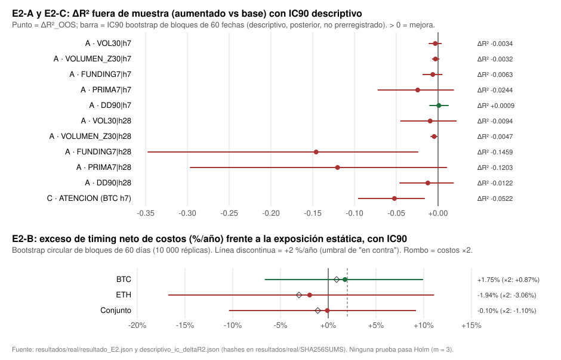

# Informe comparativo de la ronda E2 (E2-A, E2-B, E2-C), 2026-10-19

**Para la revisión crítica conjunta.** Hay una sola ejecución por experimento, con reglas congeladas antes de mirar los datos. Todo lo que aparece aquí sale de archivos con hash (Anexo A).

## Resumen

| | E2-A: compuerta de información incremental | E2-B: funding extremo como señal contraria | E2-C: atención en Wikipedia |
|---|---|---|---|
| Tipo | Predictiva, sin costos | **Operable**, con costos | Predictiva, sin costos |
| Datos | Reutilizados (T y H-CARRY) | Reutilizados (T y H-CARRY) | **Nuevos** (vistas de Wikipedia) más precio de BTC reutilizado |
| Estadístico principal | p de familia 1,0 (p mínimo sin ajustar 0,140) | Exceso de timing −0,10 %/año, IC90 [−10,4 %, +9,2 %] | Clark–West t = −1,39, p = 0,918; ΔR² = −5,2 % |
| Holm (m = 3) | No rechaza | No rechaza | No rechaza |
| **Clasificación prerregistrada** | **INSUFICIENTE** (de hecho, casi nula) | **INSUFICIENTE** (estimación puntual negativa) | **EN CONTRA** |

**Conclusión:**
- Ninguna de las tres hipótesis tiene respaldo.
- Ninguna justifica una nueva validación histórica.
- La compuerta E2-A no abre: con estas variables y modelos lineales no hay base para «agregar indicadores» ni para un filtro de IA (C13).

*La figura es descriptiva. Los intervalos de ΔR² se calcularon después de la clasificación y no la alteran (§5).*

---

## Cronología: cuándo se fijó cada cosa

| Hora (UTC, 2026-10-19) | Hecho | Evidencia |
|---|---|---|
| 23:18:21 | Prerregistro congelado. Hasta ese momento solo se había bajado **1 día** de Wikipedia, para probar la API; no se había calculado ninguna variable ni prueba. | `prerregistro/HUELLAS.txt`, SHA `5b3136d0…aa6c` |
| Entre 23:18 y 23:24 | Descarga completa de Wikipedia. Prueba sintética de Clark–West. Correcciones de implementación detectadas por los controles, **sin datos reales de resultados**: (a) la base y el modelo aumentado usan las mismas filas; (b) la invariancia se compara variable por variable; (c) el control de entrenamiento verifica t − s ≥ h. | `logs/01_prueba_cw_sintetica.txt` |
| 23:24:36 | Código, datos nuevos y prueba sintética fijados con hash. Nota de implementación sobre PRIMA7 (≥ 160 de 168 h). | `HUELLAS.txt` |
| 23:25:13 | **Ejecución única** con datos reales (validez, después pruebas, después clasificación). | `logs/02_ejecucion_real.txt`, `resultado_E2.json` |
| Después | IC90 **descriptivo** de ΔR² y figura. Ninguno de los dos cambia la clasificación. | `descriptivo_ic.py`, `grafico_svg.py` |

---

## 1. Resultados por separado

### E2-A: compuerta de información incremental (predictiva)

**Diseño:**
- panel BTC y ETH con interceptos por activo; la base usa el momentum de T;
- OLS con ventana expansiva desde el 2020-01-08;
- pronósticos desde el 2021-01-01 (h = 7 hasta el 2026-05-24; h = 28 hasta el 2026-05-03);
- Clark–West con Newey–West (rezagos = h).

| Variable · h | n pronósticos (fechas) | t de CW | p unilateral | ΔR²_OOS | IC90 descriptivo de ΔR² | Umbral de Holm interno | ¿Pasa? |
|---|---|---|---|---|---|---|---|
| VOL30 · 7 | 3940 (1970) | −0,36 | 0,641 | −0,34 % | [−1,12 %, +0,44 %] | 0,0125 | no |
| VOLUMEN_Z30 · 7 | 3940 (1970) | −0,64 | 0,739 | −0,32 % | [−0,72 %, +0,16 %] | 0,0167 | no |
| FUNDING7 · 7 | 3940 (1970) | −0,34 | 0,634 | −0,63 % | [−1,86 %, +0,52 %] | 0,0100 | no |
| PRIMA7 · 7 (solo BTC) | 1939 | +0,54 | 0,294 | −2,44 % | [−7,23 %, +1,90 %] | 0,0056 | no |
| **DD90 · 7** | 3940 (1970) | **+1,08** | **0,140** | **+0,09 %** | [−1,04 %, +1,27 %] | 0,0050 | no |
| VOL30 · 28 | 3898 (1949) | +0,06 | 0,476 | −0,94 % | [−4,52 %, +2,22 %] | 0,0071 | no |
| VOLUMEN_Z30 · 28 | 3898 (1949) | −1,08 | 0,860 | −0,47 % | [−0,91 %, −0,09 %] | 0,0250 | no |
| FUNDING7 · 28 | 3898 (1949) | −1,45 | 0,926 | **−14,59 %** | [−34,76 %, −2,36 %] | 0,0500 | no |
| PRIMA7 · 28 (solo BTC) | 1918 | −0,20 | 0,580 | −12,03 % | [−29,69 %, +1,08 %] | 0,0083 | no |
| DD90 · 28 | 3898 (1949) | +0,15 | 0,439 | −1,22 % | [−4,62 %, +1,89 %] | 0,0063 | no |

- **p de familia:** p_A = min(1; 10 × 0,1397) = **1,0**.
- **9 de 10** combinaciones empeoran el pronóstico fuera de muestra. La única mejora (DD90, h = 7) es de +0,09 % de R², con p = 0,14.
- En **FUNDING7 a 28 días**, agregar la variable **empeora mucho** el pronóstico (ΔR² −14,6 %; el IC descriptivo queda entero por debajo de 0).
  - Una explicación posible: el coeficiente es inestable, porque al principio se estima con ≈ 1 año de datos (2020, alcista y con funding alto). **No lo verifiqué**: sería un análisis nuevo.
- **¿Por qué t > 0 con ΔR² < 0 (PRIMA7, h = 7)?** Clark–West corrige el ruido de estimar un parámetro de más en el modelo anidado. Un t positivo no significativo con ΔR² negativo indica que la pérdida se explica, en parte, por ese ruido. No indica información.
- **Clasificación: INSUFICIENTE.**
  - EN CONTRA exigía que **las 10** tuvieran ΔR² ≤ 0 y p ≥ 0,10.
  - La condición de p se cumple en las 10. La de ΔR² falla **solo** por el +0,09 % de DD90 a 7 días.
  - El resultado está en el límite de la clasificación, pero no hay evidencia de información incremental.

### E2-B: funding extremo como señal contraria (operable, con costos)

**Regla:**
- exposición 1 si F7 ≤ P10 expansivo; 0 si F7 ≥ P90; 0,5 en el resto;
- ejecución en la apertura de t+1 con `tendencia.backtest.simular`, el código congelado de T;
- costos de 10 + 5 pb por lado;
- ventana [2020-07-06, 2026-06-01), 2156 días.

**Métrica:** retorno de la regla con costos menos el de la exposición estática igual a la media de la regla (rebalanceo diario, sin costos), anualizado.

| | Exceso neto (%/año) | IC90 (bootstrap de bloques de 60 días) | P(exceso > 0) | Exceso con costos ×2 |
|---|---|---|---|---|
| BTC | +1,75 | [−6,65, +9,93] | 0,642 | +0,87 |
| ETH | −1,94 | [−16,76, +11,09] | 0,441 | −3,06 |
| **Conjunto** (media diaria BTC+ETH) | **−0,10** | **[−10,40, +9,20]** | **0,521** (p_B = 0,479) | **−1,10** |

**Clasificación: INSUFICIENTE (estimación puntual negativa).**
- No es FAVORABLE: no pasa Holm, el exceso con costos ×2 del conjunto es < 0 y ETH es < 0.
- No es EN CONTRA: el límite superior del IC90 es +9,2 %, por encima del umbral de +2 %/año.

### E2-C: atención en Wikipedia (predictiva)

**Diseño:**
- A(t) = ln(media de las vistas de t−7…t−1 / media de t−35…t−29); en t solo se usan vistas hasta d−1;
- base: y = a + b·M, con M = momentum de 28 días; objetivo: retorno de BTC a 7 días;
- entrenamiento desde el 2017-09-14; pronósticos del 2018-03-19 al 2026-05-24.

| n pronósticos | t de CW | p unilateral | ΔR²_OOS | IC90 descriptivo de ΔR² | Días sin variable |
|---|---|---|---|---|---|
| 2989 | −1,39 | 0,918 | **−5,22 %** | [−9,58 %, −1,58 %] | 0 (0 %) |

**Clasificación: EN CONTRA** (ΔR² ≤ 0 y p ≥ 0,10). No queda inconcluso: no faltó ningún día de vistas.
- Agregar la atención **empeora** el pronóstico frente al momentum solo. Ni el extremo favorable del IC descriptivo es positivo.

---

## 2. Hipótesis y datos de cada prueba

| | Hipótesis (prerregistrada) | Activos, período | Datos | ¿Reutilizados? |
|---|---|---|---|---|
| E2-A | Alguna de 5 variables de estado (VOL30, VOLUMEN_Z30, FUNDING7, PRIMA7, DD90) mejora fuera de muestra el pronóstico del retorno a 7 y 28 días frente al momentum de T | BTC y ETH (PRIMA7 solo BTC); entrenamiento 2020-01-08 →; pronósticos 2021-01 → 2026-05 | Spot diario de Binance (data.binance.vision), funding y prima del perpetuo | **Sí.** Precios usados en T; funding y prima en H-CARRY (no como señal direccional) |
| E2-B | Variar la exposición spot en contra del funding extremo agrega valor de timing neto de costos | BTC y ETH spot; 2020-07-06 → 2026-05-31 | Spot diario y funding del perpetuo del mismo activo | **Sí** (ídem) |
| E2-C | El cambio de 4 semanas en las vistas del artículo «Bitcoin» mejora el pronóstico a 7 días frente al momentum de 4 semanas | BTC; pronósticos 2018-03 → 2026-05 | Vistas: API REST de Wikimedia (en.wikipedia, all-access, **user**, diario 2015-07-01 → 2026-05-31; 3988 días; 575 742 bytes; SHA `8d9a43b4…69d7`) | **Vistas nuevas**; precio de BTC reutilizado |

**Disponibilidad temporal:**
- el día d se evalúa con lo que existe al **cierre de d**: funding con `calc_time` < 00:00 de d+1; prima con velas que cierran ≤ 00:00 de d+1; Wikipedia hasta d−1;
- el período reservado (desde 2026-06) no se tocó: `tendencia.datos.leer` rechaza esos días.

**Por qué importa que los datos estén reutilizados:**
- en E2-A y E2-B, quien diseñó la prueba ya conocía las series y los regímenes del período (alcista de 2021, caída de 2022, ETF de 2024);
- por eso, un resultado **favorable** no habría sido una confirmación independiente;
- con resultados nulos o en contra, la contaminación pesa poco: no hubo un sesgo que favoreciera encontrar algo.

---

## 3. Métricas, costos, intervalos y comparación con referencias

### Referencias
- **E2-A:** base = interceptos por activo + momentum de T. Es una referencia **exigente**: la pregunta es si hay información **más allá** de una señal ya conocida, no frente a la media histórica sola.
- **E2-B:**
  - primaria: exposición estática igual a la media de la regla (aísla el timing del efecto de estar invertido en promedio);
  - descriptiva: buy and hold.
- **E2-C:** base = constante + momentum de 28 días.

### E2-B: descripción completa (la única prueba con costos)

| | Regla BTC | Estática BTC | Buy and hold BTC | Regla ETH | Estática ETH | Buy and hold ETH |
|---|---|---|---|---|---|---|
| CAGR | 29,2 % | 26,7 % | 42,6 % | 29,1 % | 33,9 % | 44,6 % |
| Volatilidad anual | 31,4 % | 31,9 % | 57,8 % | 49,9 % | 46,3 % | 78,4 % |
| Sharpe (rf = 0) | 0,97 | 0,90 | 0,90 | 0,76 | 0,86 | 0,86 |
| Caída máxima | 53,9 % | 52,5 % | 76,6 % | 60,2 % | 58,4 % | 79,3 % |

| | BTC | ETH |
|---|---|---|
| Exposición media | 0,552 | 0,591 |
| Días con exposición 1 / 0,5 / 0 | 217 / 1852 / 87 (10,1 % / 85,9 % / 4,0 %) | 368 / 1709 / 79 (17,1 % / 79,3 % / 3,7 %) |
| Episodios en la cola baja (largo) / la cola alta (efectivo) | 25 / 9 | 34 / 10 |
| Operaciones / rotación anual | 69 / 5,2× | 89 / 7,1× |
| Costo efectivo ≈ rotación × 15 pb | ≈ 0,8 pp/año | ≈ 1,1 pp/año |
| `costes_pp_anual` (métrica de T) | 2,38 | 4,42 |

**Costos:**
- La métrica `costes_pp_anual` de T divide los costos totales por el **capital inicial** (`metricas.py:47`). Con un capital que se multiplica por ≈ 4 en el período, **sobreestima** el lastre.
- El lastre efectivo, ≈ rotación × 15 pb, coincide con la diferencia entre costos ×1 y ×2: 0,88 pp en BTC, 1,12 pp en ETH y 1,00 pp en el conjunto.
- **Exceso bruto aproximado** (extrapolación lineal de ×1 a ×0): BTC ≈ +2,6 %/año, ETH ≈ −0,8 %/año, conjunto ≈ +0,9 %/año.
- Incluso sin costos, el valor de timing es indistinguible de cero.

**Colas:** no suman 10 % + 10 % porque los percentiles son expansivos y el nivel del funding no es estacionario. En ETH, el funding quedó por debajo de su P10 expansivo el 17 % de los días.

### Dependencia temporal y potencia

| | n nominal | n efectivo aprox. | Tratamiento de la dependencia | Efecto mínimo detectable (80 %) [Hip] |
|---|---|---|---|---|
| E2-A, h = 7 | 1970 fechas × 2 activos | ≈ 280 por activo (1970/7). BTC y ETH están muy correlacionados, así que el panel suma bastante menos que ×2 | Newey–West, 7 rezagos | ΔR² ≈ 2 % (α = 0,05) a ≈ 4 % (α = 0,005, Bonferroni) |
| E2-A, h = 28 | 1949 × 2 | ≈ 70 por activo | Newey–West, 28 rezagos | ΔR² ≈ 9 % a ≈ 17 % |
| E2-B | 2156 días | 25–34 episodios en la cola baja y 9–10 en la alta por activo | Bootstrap circular de bloques de 60 días | **≈ 15 %/año** (α = 0,05) a **≈ 18 %/año** (α = 0,0167). Error estándar ≈ 6,0 %/año. Potencia frente a un efecto verdadero de +2 %/año: ≈ 10 %; de +5 %/año: ≈ 21 % |
| E2-C | 2989 | ≈ 430 | Newey–West, 7 rezagos | ΔR² ≈ 1,5 % (α = 0,05) |

- Los efectos mínimos de E2-A y E2-C son aproximaciones ([Hip]) del tipo t ≈ √(n_ef·R²), dentro de muestra. Fuera de muestra son mayores.
- Como escala, [Pub*] Campbell y Thompson (2008) muestran que un R² mensual de ≈ 0,5 % ya puede ser económicamente relevante. **E2-A no puede ver efectos de ese tamaño**: por eso «insuficiente» es honesto y no se debe leer como «demostrado que no hay nada».
- E2-C sí tiene resolución para descartar mejoras de unos pocos puntos de R², y el ΔR² observado es negativo.

### Predicción frente a rentabilidad
- **E2-A y E2-C** miden información predictiva sin costos ni regla. Un resultado favorable **no** habría significado rentabilidad.
- **E2-B** es la única que mide rentabilidad neta operable.
- Los tres resultados coinciden: no hay información (A y C) ni valor operable (B).

---

## 4. Corrección por pruebas múltiples

- **Entre experimentos (Holm, m = 3, α = 5 %):**

| Orden | Experimento | p | Umbral de Holm | Decisión |
|---|---|---|---|---|
| 1 | E2-B | 0,479 | 0,0167 | No rechaza, y Holm se detiene |
| 2 | E2-C | 0,918 | 0,0250 | No rechaza |
| 3 | E2-A | 1,000 | 0,0500 | No rechaza |

- **Dentro de E2-A:**
  - el p de familia de Bonferroni, min(1; 10 × p_mín), entra en Holm; combinado con Holm entre experimentos es un procedimiento cerrado válido;
  - Bonferroni es conservador con 10 pruebas correlacionadas, pero acá **no importa**: el p mínimo **sin ajustar** (0,140) ya supera el 5 %;
  - el Holm interno de las 10 no rechaza ninguna (umbral mínimo 0,005).
- **No se agregaron pruebas después de mirar.** Los IC de ΔR² y la figura son descriptivos y no tienen p.

---

## 5. Controles de calidad y limitaciones

### Controles de validez (antes de interpretar; todos superados: `validez.json`, `todo_ok: true`)

| Control | Resultado |
|---|---|
| Hashes y checksums | Spot de BTC y ETH: 106 archivos cada uno, con manifiesto SHA verificado. Funding y prima: 77 zips cada uno contra el `.CHECKSUM` oficial. Wikipedia: SHA fijado antes de la ejecución |
| Huecos ≤ 1 % | Spot: 0 días ausentes de 3210. Funding: 7029 de 7029 liquidaciones. Prima de BTC: 169 de 56 232 horas faltantes (0,30 %). Wikipedia: 0 de 3988 |
| OHLC | 0 incoherentes, 0 repetidas, 0 precios no positivos |
| Entrenamiento sin futuro | 44 846 filas comprobadas con t − s ≥ h; además, un `assert` en el OLS |
| Invariancia frente al futuro | 5 cortes al azar (2021-10-04, 2022-04-10, 2022-11-22, 2024-05-21 y 2025-02-20). Variables de A y B, atención de C, pronósticos de A y C y exposiciones de B **idénticos** hasta cada corte |
| Clark–West sintético | Rechazo bajo el nulo verdadero: 0,02 (algo conservador, como se espera). Potencia ante una alternativa sintética grande: 1,0. **Valida la implementación, no la potencia ante efectos realistas** |
| Integridad posterior | `resultados/real/SHA256SUMS`: 4/4 OK. Prerregistro, código, datos y prueba sintética siguen coincidiendo con `HUELLAS.txt` |

### Limitaciones
1. **Datos reutilizados y período conocido** (E2-A, E2-B y el precio en E2-C). Ver §2.
2. **Solo modelos lineales en E2-A y E2-C.** Las no linealidades solo se exploran en las colas del funding (E2-B), no en volumen, volatilidad, prima, drawdown ni atención. Un efecto solo en regímenes no queda excluido, pero buscarlo ahora con estos datos sería minería.
3. **Un solo exchange** (Binance) para funding y prima; no es el posicionamiento de todo el mercado.
4. **PRIMA7 con ≥ 160 de 168 horas:** el prerregistro no fijaba cómo tratar las horas faltantes. Lo decidí al implementar, antes de la ejecución, y lo dejé registrado en `HUELLAS.txt`. Afecta a muy pocas ventanas (0,30 % de horas faltantes) y la variable no mostró información.
5. **Wikipedia:**
   - se usa solo el artículo en inglés «Bitcoin» y el agente «user»;
   - el filtro de tráfico automatizado de 2020 puede generar un escalón. No se ajustó (prerregistro §3); la variable de cambio de 4 semanas lo absorbe salvo en unos 35 días;
   - la fuente es nueva para el proyecto, pero el artículo concreto y el horizonte los elegí yo a partir de la literatura.
6. **Los IC90 de ΔR² son descriptivos y posteriores:** se calculan con los pronósticos fijos, sin incertidumbre de estimación, y no forman parte de ninguna decisión.
7. **E2-B tiene potencia muy baja** (≈ 10 % frente a un efecto verdadero de +2 %/año). El resultado «insuficiente» era el esperado, y así lo anunciaba el prerregistro.
8. **E2-A al comienzo:** el entrenamiento de ≈ 1 año (2020) puede generar coeficientes inestables, sobre todo a 28 días. Es parte del diseño prerregistrado (ventana expansiva desde 2020-01-08), no una falla. Un inicio más tardío habría dejado aún menos pronósticos.
9. **Gráfico:** está en SVG, generado con la biblioteca estándar. No instalé librerías de gráficos.

---

## 6. Clasificación

| Experimento | Clasificación prerregistrada | Lectura sustantiva |
|---|---|---|
| E2-A | **INSUFICIENTE** | Sin evidencia de información lineal incremental en 5 variables a 1 y 4 semanas. Está a un ΔR² de +0,09 % de «en contra». No permite descartar efectos chicos pero económicamente relevantes |
| E2-B | **INSUFICIENTE (estimación puntual negativa)** | Exceso neto de timing ≈ 0 (−0,10 %/año). Signos opuestos en BTC y ETH. Negativo con costos ×2. Sin capacidad para detectar efectos menores de ≈ 15 %/año |
| E2-C | **EN CONTRA** | La atención en Wikipedia empeora el pronóstico a 7 días frente al momentum, de 2018 a 2026 |

**Ninguna es FAVORABLE. Ninguna pasa Holm.**

---

## 7. Qué justifica una nueva validación y qué se descarta

**Se descarta:**
- **C2 / E2-C (atención en Wikipedia):** DESCARTADA. No se reabre con otros artículos, idiomas, ventanas ni horizontes, porque eso sería buscar la variante que funcione en los mismos datos.
- **C3 / E2-A como vía para «agregar indicadores»:** la compuerta **no abrió**. Queda descartado construir estrategias o filtros sobre VOL30, VOLUMEN_Z30, FUNDING7, PRIMA7 o DD90 a 1–4 semanas.
- **C13 (IA de selección o abstención):** estaba condicionada a que C3 encontrara información. Queda **sin base**.
- **DD90 a 7 días:** **no** se persigue. Es la mejor de 11 lecturas (10 de E2-A y E2-C), con +0,09 % de R² y p = 0,14. Elegirla ahora sería seleccionar por el resultado.
- **C1 / E2-B (funding extremo):** se **archiva** como INSUFICIENTE con estimación puntual ≈ 0.
  - Ningún dato histórico adicional del mismo exchange resolvería un efecto plausible (de 2 a 5 %/año) con una potencia razonable: haría falta un error estándar de 3 a 7 veces menor, es decir, entre ≈ 9 y ≈ 55 veces más datos independientes.
  - No recomiendo seguirlo ni en papel.

**Qué justificaría una nueva validación:**
- Solo una hipótesis **nueva**, con un mecanismo propio y datos **no vistos**.
- Ya existen dos candidatas fuera del alcance autorizado, y **no** las ejecuté:
  - **H-E1-BC** (confianza de breakout en ETH y SOL, con el protocolo borrador listo; requiere descargar datos);
  - **C5** (momentum transversal entre criptos; requiere un universo histórico).
- Ninguna de las dos se apoya en los resultados de E2.

---

## 8. Qué aporta cada experimento que no aportan los otros

- **E2-A (la más amplia):**
  - es la única que prueba **varias fuentes de estado a la vez** (volumen, volatilidad, drawdown, funding y prima), en dos horizontes y frente a la señal de T ya conocida;
  - por eso funciona como **compuerta**: su resultado decide si tiene sentido construir filtros o modelos de IA sobre esas variables;
  - su límite: es lineal y sin costos.
- **E2-B (la única operable):**
  - es la única que mide **rentabilidad neta** con costos reales, ejecución en t+1 y comparación con la exposición estática;
  - además prueba una **no linealidad** (solo los extremos) que la regresión lineal de E2-A no captura;
  - junto con FUNDING7 de E2-A (que empeora el pronóstico a 7 y a 28 días), cierra el funding por dos vías: ni el nivel lineal ni las colas aportan algo detectable;
  - su límite: la potencia.
- **E2-C (la única con datos nuevos):**
  - es la única prueba **no contaminada** por las series que el proyecto ya había mirado;
  - su muestra es más larga (2018–2026);
  - el mecanismo es distinto (comportamiento o atención, no precio ni apalancamiento);
  - es la única con un resultado **EN CONTRA**: el más informativo de la ronda;
  - [Pub] Liu y Tsyvinski (RFS 2021) encontraron poder predictivo en indicadores de atención, con una muestra hasta 2018. Este resultado no refuta ese trabajo, pero muestra que **su versión con Wikipedia a 7 días no agrega nada al momentum después de 2018**, lo que es compatible con un efecto debilitado o específico de esa época;
  - su límite: es un solo artículo y un solo horizonte.

---

## 9. Restricciones y estado del repositorio

| Restricción | Cumplimiento | Evidencia |
|---|---|---|
| Sin dinero real ni trading real; sin tocar producción | Sí | Solo simulación local con código de investigación |
| Sin commits, pushes, merges, rebases, cherry-picks ni deploys | Sí. El entorno mostró avisos automáticos pidiendo commit y push, y los rechacé | HEAD `692f2b2` (2026-10-18T05:05Z), sin stash |
| No modificar código, configuración ni archivos del repositorio | Sí | `git status`: las **mismas 8 entradas** previas (3 modificadas y 5 sin seguimiento), todas con fecha del **2026-10-17**. Ningún archivo del repositorio (excluido `.git`) se modificó desde el 2026-10-19 00:00 UTC. No se crearon `__pycache__`. El código de T se usó por `PYTHONPATH`, solo lectura |
| No alterar E1, T-MULTI ni sus artefactos congelados | Sí | E1 `resultados/real/SHA256SUMS`: 6/6 OK. Fase de investigación de E2: `SHA256SUMS` 3/3 OK. T-MULTI vive en el repositorio, sin cambios (ver arriba) |
| Sin instalar dependencias | Sí | Reutilicé el venv aislado de E1 (Python 3.11.17, numpy 2.4.6). La figura se hizo con la biblioteca estándar |
| Descargas: solo Wikipedia (< 1 MB) | Sí | 4 solicitudes a la API de Wikimedia: • sonda de 1 día **antes** del prerregistro (23:16:38, respuesta 429 por límite de tasa; 23:17:13, respuesta 200 con 1 valor); • descarga completa **después** del prerregistro (23:18:30, respuesta 429; 23:19:01, respuesta 200, 575 742 bytes). Las respuestas no traían `Retry-After`, así que esperé antes de reintentar, como indica la documentación. Consulté 1 página de documentación (límites de tasa de Wikimedia). **No** bajé ETH ni SOL ni ningún otro dato |
| Sin experimentos no aprobados ni otras familias | Sí | Solo E2-A, E2-B y E2-C según el prerregistro. Los IC de ΔR² y la figura son descriptivos |
| Sin parámetros elegidos por rentabilidad | Sí | Todos fijados en el prerregistro antes de los datos |
| Sin credenciales ni datos personales | Sí | User-Agent sin el correo del usuario. Las cabeceras guardadas de Wikimedia no contienen cookies |
| Registro de hipótesis | Actualizado **como archivo nuevo** (`informe/REGISTRO_HIPOTESIS_tras_E2.md`). El original de la fase de investigación sigue intacto, con su hash | `SHA256SUMS` de la fase de investigación: OK |

---

## Preguntas para la revisión crítica conjunta
1. ¿La base con el momentum de T es demasiado exigente para E2-A? La pregunta prerregistrada era la información **incremental**, pero una comparación contra la media histórica sola sería otra hipótesis, y habría que prerregistrarla aparte.
2. ¿El ΔR² muy negativo de FUNDING7 y PRIMA7 a 28 días refleja inestabilidad de los coeficientes con un entrenamiento inicial corto? ¿Conviene documentarlo como lectura descriptiva sin decisiones o dejarlo así?
3. En E2-B, ¿la métrica de exceso frente a la estática equivalente es la adecuada para una regla de tres estados centrada en 0,5? Sugerencias que sirvan para **futuras** reglas, no para reabrir esta.
4. ¿Hay alguna razón (que no venga de estos resultados) para dudar de la clasificación EN CONTRA de E2-C, por ejemplo por el escalón de 2020 en Wikipedia?
5. ¿Las dos candidatas restantes (H-E1-BC y C5) merecen la autorización de descarga que requieren, o conviene cerrar la búsqueda de señales históricas y dejar que T-papel avance prospectivamente?

---

## Anexo A: archivos de la ronda (todos bajo `E2_descubrimiento_2026-10-19/ronda_E2/`)

| Archivo | SHA-256 | Rol |
|---|---|---|
| `prerregistro/PRERREGISTRO_E2.md` | `5b3136d0256021a1bad126fbb4c31c5079599528161a48cba3485feeae34aa6c` | Reglas congeladas |
| `prerregistro/HUELLAS.txt` | (ver `informe/SHA256SUMS`) | Cronología de los hashes |
| `codigo/e2.py` | `9a8df486cbb0320b48110047964148c3738a9c15015a9915271d3f0c2b5ed2b2` | Ejecución única |
| `datos/wikipedia_bitcoin_pageviews.json` | `8d9a43b4d9e55c5e03f914b48189638939569fa4fd672530770d51eebceb69d7` | Datos nuevos (respuesta cruda) |
| `resultados/prueba_cw_sintetica.json` | `a31338bf52e9384b6bf0e57147d834bfa7d3d8cf244d812241ad8588f613a519` | Prueba del estimador |
| `resultados/real/resultado_E2.json` | `379b4cd464af06e5f5ab8c10259c06e43847e367b75d7f6dbc075bbc91a6099e` | Resultados y clasificación |
| `resultados/real/validez.json` | `7a50c3281d778108fc56e8ecabd3c43e0a8a1eb0cc80abf5795b71100bcdf20c` | Controles |
| `resultados/real/pronosticos_y_exposiciones.json` | `1321ec3f3cd1f356888dfde9179fb28c0360cb177248ec1c7c0406dd329adf00` | Series para auditar |
| `resultados/real/descriptivo_ic_deltaR2.json` | `c4642bf816d9db17f02156a7d1d53fa5361341723f0901ed70b02e2a3927893d` | IC descriptivos (posteriores) |
| `codigo/descriptivo_ic.py`, `codigo/grafico_svg.py`, `informe/*` | `informe/SHA256SUMS` | Descriptivos e informe |
| `logs/01–03` | — | Salidas de consola |

**Reproducir:**
- usar el venv de E1 con `PYTHONPATH=research/tendencia_btc/src:research/hcarry_next/src`;
- ejecutar `python -B codigo/e2.py prueba_cw <salida.json>` y `python -B codigo/e2.py ejecutar <dir_resultados>` (los datos locales de T y H-CARRY se leen con verificación de hash);
- el bootstrap usa la semilla 20261019.
